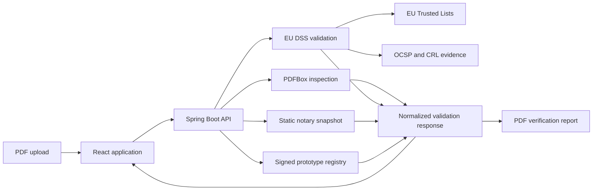

<div align="center">

# Signature Validator

### Understand the evidence behind a digitally signed PDF.

Upload a PDF, verify its embedded signatures with EU DSS, inspect certificate and eIDAS trust evidence, compare signer identities with a static Austrian notary-directory snapshot, and check exact-document provenance against a signed prototype Notarity registry.

**Private by design · Stateless processing · No database · No document retention**

[Get started](#quick-start) · [Explore the API](#api) · [Read the trust model](docs/TRUST_VALIDATION.md) · [View the API contract](docs/API_CONTRACT.md)

</div>

---

## What it does

Signature Validator turns complex PDF-signature evidence into a result that is useful to both non-technical recipients and specialist reviewers. Each trust question is evaluated independently, so a successful document-integrity check never silently implies certificate trust, notary status, or a Notarity record.

| Evidence dimension | What the application answers |
|---|---|
| Document integrity | Has the signed content or PDF byte range been modified? |
| Embedded signatures | Which supported PAdES signatures and seals are present? |
| Signature level | What eIDAS qualification can DSS establish? |
| Certificate trust | Does the certificate chain to an authenticated EU trust service? |
| Notary directory | Does a person signer match the static Austrian snapshot? |
| Notarity record | Does the exact document match a signed prototype registry receipt? |

The result page presents the overall outcome, every embedded signature, certificate and timestamp evidence, registry checks, a compact audit trail, and a downloadable PDF verification report.

## Evidence boundaries

The interface deliberately separates production-grade validation from prototype business integrations.

### Real validation

- PDF structure, page count, encryption detection, and the 25 MB upload limit
- SHA-256 document fingerprinting
- Embedded PAdES signature and electronic-seal extraction
- Signature-value, signed-content, byte-range, and PDF revision validation
- Signer-certificate metadata and SHA-256 fingerprints
- Claimed and trusted signing-time separation
- Timestamp and PAdES profile extraction
- EU Trusted List certificate-chain evaluation
- Bounded OCSP and CRL revocation evaluation
- Trust-service provider and eIDAS qualification mapping
- Multi-signature documents and normalized structured errors
- Vector PDF verification-report generation from the normalized response

### Prototype integrations

- A small, incomplete static snapshot of public Austrian notarial-signature records
- A local exact-document Notarity registry backed by signed JSON records
- Ed25519 receipt verification and certificate-fingerprint participant binding
- A tamper-evident prototype audit trail

Prototype registry results do not claim access to Notarity production systems. The Austrian directory snapshot is neither live nor exhaustive.

## Architecture



| Layer | Technology |
|---|---|
| Frontend | React 18, TypeScript, Vite, React Router, TanStack Query, Zod, Lucide |
| Backend | Java 21, Spring Boot, Spring Web, Validation, Actuator, springdoc-openapi |
| Validation | EU DSS 6.4, Apache PDFBox 3 |
| Cryptography | SHA-256, Ed25519, DSS-compatible Bouncy Castle |
| Delivery | Docker, Docker Compose, nginx |
| Persistence | No database; only authenticated trust-list cache and versioned prototype JSON |

The controller performs request validation and PDF inspection before delegating immutable document bytes to the replaceable `SignatureValidationService`. `DssSignatureValidationService` is the default implementation; `FixtureSignatureValidationService` remains available for deterministic UI development and tests.

## Quick start

### Docker Compose

Prerequisite: Docker Desktop or another Docker installation with Compose.

```bash
docker compose up --build
```

Then open:

- Application: <http://localhost:5173>
- Backend API: <http://localhost:8080/api/v1>
- Swagger UI: <http://localhost:8080/swagger-ui.html>
- OpenAPI JSON: <http://localhost:8080/v3/api-docs>

The first start downloads and authenticates the EU List of Trusted Lists and referenced national lists. This can take around two minutes. The UI is available during initialization; cryptographic checks continue to work while certificate trust is truthfully reported as pending or indeterminate.

Stop the application with:

```bash
docker compose down
```

The named `trusted-list-cache` volume survives normal rebuilds and restarts.

### Local development

Prerequisites:

- Java 21
- Node.js 20 or newer

Start the backend:

```bash
cd backend
./gradlew bootRun
```

Start the frontend in a second terminal:

```bash
cd frontend
cp .env.example .env
npm install
npm run dev
```

Useful backend modes:

```bash
# Default: real DSS validation with trust infrastructure
VALIDATION_MODE=dss ./gradlew bootRun

# Cryptographic validation without online trust initialization
SPRING_PROFILES_ACTIVE=offline ./gradlew bootRun

# Deterministic fixture responses for UI development
VALIDATION_MODE=fixture ./gradlew bootRun
```

## Validation flow

1. Select or drop a PDF of up to 25 MB.
2. The backend validates the upload, PDF magic bytes, parseability, and encryption state.
3. PDFBox extracts document metadata and page count; the backend calculates SHA-256.
4. EU DSS extracts every supported PAdES signature and evaluates cryptographic integrity.
5. When authenticated trust data is available, DSS evaluates certificate chains, revocation evidence, timestamps, trust services, and eIDAS qualification.
6. Person signers are compared with the static Austrian notary snapshot.
7. The exact document hash is checked against the signed prototype Notarity registry.
8. The frontend renders the normalized response without retaining the document or result.

Trust infrastructure failures degrade the trust conclusion—they do not erase successful cryptographic evidence or turn an intact document into an invalid one.

## API

Base path: `http://localhost:8080/api/v1`

| Method | Endpoint | Purpose |
|---|---|---|
| `GET` | `/health` | Application and trust-component health |
| `GET` | `/capabilities` | Supported media, limits, and configured capabilities |
| `POST` | `/validations` | Validate a multipart PDF and return the normalized result |
| `POST` | `/reports/pdf` | Revalidate a multipart PDF and download its verification report |

Validate a document:

```bash
curl \
  -F "document=@/path/to/document.pdf;type=application/pdf" \
  -F "includeTechnicalDetails=true" \
  -F "locale=en" \
  http://localhost:8080/api/v1/validations
```

Generate a report:

```bash
curl \
  -F "document=@/path/to/document.pdf;type=application/pdf" \
  http://localhost:8080/api/v1/reports/pdf \
  --output document-verification-report.pdf
```

Because validation results are not persisted, the report endpoint reuses the existing validation service and revalidates the uploaded document. It never accepts frontend-supplied trust conclusions. The report contains the overall result, document fingerprint, trust summary, every signature, prototype Notarity result, notary-directory result, concise disclaimers, and page numbering.

See the [generated two-page sample report](samples/verification-report-sample.pdf).

## Testing

Run the backend suite and production build:

```bash
cd backend
./gradlew test
./gradlew bootJar
```

Run the frontend suite and production build:

```bash
cd frontend
npm install
npm test
npm run build
```

Generate and render the sample report preview:

```bash
./scripts/render-report-preview
```

Preview PNGs are written to `backend/build/report-preview/`. Backend tests generate small PDF and signed-PDF fixtures where possible; automated trust tests use deterministic local evidence rather than live EU services.

### Docker cache smoke test

```bash
./scripts/smoke-test-docker-cache
```

The backend container starts with a small root entrypoint that prepares `/app/cache/trusted-lists`, assigns it to `1001:0` with mode `775`, and then launches Java as non-root UID 1001. The Spring application does not run as root and the cache is not world-writable.

## Prototype datasets

### Notarity registry

Records are addressed exclusively by the exact lowercase SHA-256 document hash. A record is accepted only when its complete canonical payload has a valid Ed25519 signature from a trusted local public key and its participant fingerprints match real certificates extracted from the PDF.

```bash
./scripts/generate-prototype-registry-key
cp data/notarization-records/record-template.example.json data/notarization-records/my-record.json
./scripts/register-prototype-document /path/to/document.pdf data/notarization-records/my-record.json
```

The private development key stays under the Git-ignored `local/keys/` directory and is never required by the running application.

### Austrian notary snapshot

Validation uses `data/notaries.json`; no website is queried during an upload. Regenerate the curated manual snapshot with:

```bash
node scripts/notary-directory/create-snapshot.mjs --mode manual
node --test scripts/notary-directory/test/*.test.mjs
```

See [Notarity registry](docs/PROTOTYPE_NOTARITY_REGISTRY.md) and [notary-directory snapshot](docs/NOTARY_DIRECTORY_SNAPSHOT.md) for provenance, canonicalization, matching rules, tampering behavior, and limitations.

## Privacy and security

- Uploaded PDFs exist only for the current request and are not permanently stored.
- PDF bytes, extracted text, raw DSS reports, and full signer subjects are not logged.
- Filenames are sanitized before use in logs or response headers.
- The backend checks MIME information, PDF magic bytes, PDFBox parseability, encryption, and size.
- Registry records cannot provide their own trust key; keys resolve only from the local trusted public-key registry.
- Online trust and revocation access uses bounded timeouts and cached evidence.
- An unavailable external service produces a warning or indeterminate result, not a fabricated success or revocation result.

## Repository layout

```text
signature-validator/
├── frontend/                   React application and nginx image
├── backend/                    Spring Boot API, DSS integration, and tests
├── data/                       Versioned prototype registries and snapshots
├── docs/                       API, trust, registry, and comparison documentation
├── samples/                    Sample guidance and generated report example
├── scripts/                    Registry, snapshot, preview, and smoke-test tools
├── docker-compose.yml
├── KNOWLEDGE.md
└── README.md
```

## Configuration

Copy the provided examples when running outside Docker:

- [`frontend/.env.example`](frontend/.env.example)
- [`backend/.env.example`](backend/.env.example)

Common settings:

| Variable | Default | Description |
|---|---|---|
| `VITE_API_BASE_URL` | `http://localhost:8080/api/v1` | Frontend API base URL |
| `SERVER_PORT` | `8080` | Backend HTTP port |
| `ALLOWED_FRONTEND_ORIGIN` | `http://localhost:5173` | CORS origin |
| `APPLICATION_VERSION` | `0.2.0` | Validator version |
| `VALIDATION_MODE` | `dss` | `dss` or `fixture` validation service |
| `TRUST_STARTUP_TIMEOUT` | `180s` | Bound for initial trust-list loading |
| `PROTOTYPE_NOTARY_REGISTRY_FILE` | `../data/notaries.json` | Local static snapshot |

No secrets belong in committed environment files.

## Current limitations

- Cold trust initialization requires network access to EU and national trust services.
- Historical revocation can remain indeterminate when sufficient embedded or reachable evidence is unavailable.
- A claimed PDF signing time is informational and is never treated as trusted by itself.
- The Austrian notary snapshot is deliberately small, static, incomplete, and may become stale.
- The Notarity registry is local prototype data, not a production integration.
- Results are held in memory; refreshing the result route returns to upload.
- PDF is the only supported document and report format currently implemented.
- The user interface currently presents English copy.

## Further reading

- [API contract](docs/API_CONTRACT.md)
- [Trust validation](docs/TRUST_VALIDATION.md)
- [Prototype Notarity registry](docs/PROTOTYPE_NOTARITY_REGISTRY.md)
- [Prototype notary matching](docs/PROTOTYPE_NOTARY_REGISTRY.md)
- [Austrian notary-directory snapshot](docs/NOTARY_DIRECTORY_SNAPSHOT.md)
- [DSS comparison notes](docs/DSS_COMPARISON.md)

---

<div align="center">

Built to make digital-signature evidence understandable without overstating what was proven.

</div>
